<div align="center">




<a href="https://www.linkedin.com/in/jose-camacho05"></a>
<a href="mailto:camachocastelanjm@gmail.com"></a>


</div>

### `$ cat about.py`

```python
class JoseCamacho:
    role       = "Ingeniero Informático · AI/ML & Full-Stack"
    education  = "Universidad Veracruzana · 9º semestre · promedio 9.5 · egreso 2027"
    focus      = ["Machine Learning", "Audio AI", "Visión / OCR", "Backend concurrente"]
    currently  = ["Liderando QuiasmaPath", "Construyendo WaveNotes", "Explorando agentes de IA"]
    languages  = {"es": "nativo", "en": "B1 (Cambridge PET)", "de": "intermedio"}

    def philosophy(self):
        return "Si no se puede medir, no se puede optimizar."
```


### `$ ls ./proyectos --destacados`

| | Proyecto | Qué hace | Resultados clave |
|:-:|---|---|---|
| 💊 | **QuiasmaPath**<br><sub>Líder de desarrollo · 2025 – hoy</sub> | Simulador farmacocinético web para la enseñanza de farmacología. Arquitectura de 3 capas con backend propio de cálculo concurrente.<br><br>`Python` `JavaScript` `React` `Supabase` `PostgreSQL` `Firebase` | ~1 s de cálculo por fármaco · ~200 estudiantes simultáneos · carga < 5 s en móviles de gama baja |
| 🎵 | **[WaveNotes](https://github.com/ElCamacho05/WaveNotes)**<br><sub>Desarrollador único · 2026 – hoy</sub> | Análisis de canciones con IA: separa instrumentos con Demucs (Hybrid Transformer) y extrae notas por instrumento (pitch tracking, onsets, chroma). Microservicio de IA + web app Java, ambos en contenedores.<br><br>`PyTorch` `Demucs` `librosa` `FastAPI` `Java Servlets/JSP` `Tomcat` `Maven` `Firebase` `Docker` | Canción de 4 min analizada en < 30 s · 400 ms de Python al frontend |
| 🧾 | **[DeepTicket](https://github.com/ElCamacho05/DeepTicket)**<br><sub>Líder de equipo (4 devs) · 2025 – 2026</sub> | App Android de control de gastos: escanea tickets con OCR, normaliza productos con fuzzy matching y recomienda con KNN desde una API propia.<br><br>`Kotlin` `Jetpack Compose` `CameraX` `ML Kit` `Hugging Face (Donut)` `scikit-learn` `FastAPI` `Supabase` `Ktor` | 96 % de precisión en escaneo · dataset sintético de 20k+ registros · entregas ~1 semana antes |
| 👶 | **[BabyGuard Pro](https://github.com/denissexocuis/BabyGuard-Pro)**<br><sub>Contribuidor principal · equipo de 4 · 2026</sub> | Monitor de bebé IoT con visión por computadora: cámara ESP32 transmite a un servidor en Raspberry Pi que detecta riesgos en tiempo real y alerta por Telegram. Desarrollé el motor de IA.<br><br>`Python` `OpenCV` `MediaPipe` `Flask` `MQTT (Mosquitto)` `Node-RED` `MySQL` `ESP32 (C++)` `Raspberry Pi` `Docker Compose` | Detección de bebé boca abajo y rostro cubierto (Pose + Face Mesh) · detección de llanto por energía de audio (RMS) · 4 contenedores orquestados · alertas en Telegram + dashboard |

### `$ ls ./proyectos --todos`

| | Proyecto | Qué hace | Lo técnico |
|:-:|---|---|---|
| 🖥️ | **[Proyecto-SO](https://github.com/ElCamacho05/Proyecto-SO)**<br><sub>Equipo de 5 · 2026</sub> | Simulador de un sistema operativo completo en escritorio: kernel, sistema de archivos con permisos, usuarios, terminal y suite de apps (IDE, explorador, reproductor, juegos, red social).<br><br>`Python` `Tkinter` `Pygame` `Pillow` `sockets` `threading` | Planificador de procesos FIFO, Round Robin y por prioridad · gestión de memoria · cliente-servidor por sockets |
| 🦠 | **[Virus-Simulator](https://github.com/ElCamacho05/Virus-Simulator)**<br><sub>Proyecto universitario · 2025</sub> | Simulación de propagación epidemiológica entre personas y regiones, visualizada en tiempo real.<br><br>`C` `OpenGL` `GLUT` `Make` | Grafos de contagio con BFS · ruta de contagio más probable · min-heap, hashing · merge/heap/quicksort · librería gráfica propia (`libigl.a`) |
| 🤖 | **[ToyFactory](https://github.com/ElCamacho05/ToyFactory)**<br><sub>Proyecto universitario · 2025</sub> | Fábrica de juguetes navideña animada: el usuario arma su robot por escenas y luego lo controla en un mapa procedural.<br><br>`C` `OpenGL` `GLUT` `stb_image` | Robot modelado como árbol jerárquico (torso → brazo → mano → herramienta) · escenas en árbol · vista isométrica |
| ⛅ | **[AnotherWeatherApp](https://github.com/ElCamacho05/AnotherWeatherApp)**<br><sub>Proyecto universitario · 2025</sub> | App Android de clima con ubicaciones guardadas, pronóstico por hora y por día, selección en mapa y publicaciones de la comunidad.<br><br>`Java` `Android SDK` `OpenWeather API` `Firebase Auth/Firestore/Storage` `Google Maps` `Glide` | Integración de API REST externa · geolocalización GPS · login con Google · contenido generado por usuarios |


### `$ pip list --stack`

**IA / ML**
<p>
  
</p>

**Backend & datos**
<p>
  
</p>

**Frontend, móvil & sistemas**
<p>
  
</p>

<sub>Además: OpenCV · MediaPipe · Hugging Face Transformers · Demucs · librosa · MQTT · Node-RED · Jetpack Compose · OpenGL · REST APIs · arquitectura de software · pruebas de concurrencia · despliegue en la nube · Assembly · microcontroladores</sub>


### `$ git log --reconocimientos`

```diff
+ 🏅 Mención Honorífica — Incubadora de Proyectos Digitales (IPD) · AMFEM 2026
+ 🐧 Instructor del taller "Linux" — FLISOL · IEEE CS 2026
+ 🚀 Proyecto representante de Veracruz — Samsung Innovation Campus 2025-2026
+ 🎓 Samsung Innovation Campus: Inteligencia Artificial · Liderazgo (UDEM / Ceneval)
```

<div align="center">

<sub><code>while(alive) { learn(); build(); ship(); }</code></sub>
</div>
